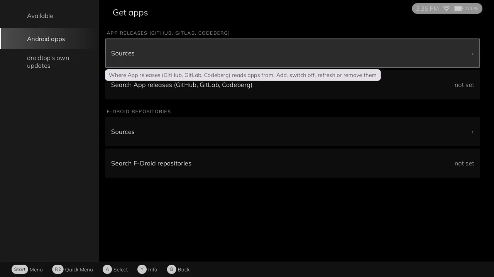

<h1 align="center">App releases for droidtop</h1>

  <b>Keep Android apps up to date from their developers' release pages.</b> 
  GitHub, GitLab, Codeberg or any Forgejo server, in the spirit of Obtainium.

  
  
  
  

  

  <a href="#what-it-does">What it does</a> ·
  <a href="#install">Install</a> ·
  <a href="#status">Status</a> ·
  <a href="#for-developers">For developers</a> ·
  <a href="#licence">Licence</a>

An app catalog plugin for [droidtop](https://github.com/Droidtop/droidtop). You add a project's releases page, and droidtop shows its newest release, downloads the right APK and installs it. This plugin only reads release pages. It is never told what is installed.

## Install

You need [droidtop](https://github.com/Droidtop/droidtop). No page is tracked by default, so start by adding one.

1. In droidtop open **Settings > Plugins > Add**. droidtop's own catalog is always there.
2. Pick **App releases (GitHub, GitLab, Codeberg)** and press **Install**.
3. Read the permissions it asks for and press **Accept**. Nothing runs until you do.

You can also browse the catalog at [droidtop.github.io](https://droidtop.github.io/), or open this plugin's install page directly: [Install in droidtop](https://droidtop.github.io/install-plugin?catalog=https%3A%2F%2Fraw.githubusercontent.com%2Fdroidtop%2Fdroidtop-platforms%2Fmain%2Fdroidtop-plugins%2Findex.json&id=droidtop.github-apps). That link only opens a review inside droidtop.

## What it does

- **Track a releases page** on GitHub, GitLab, Codeberg, or another Forgejo, Gitea or GitLab server. Add it by address or link. `owner/repo` alone means GitHub.
- **Picks the right APK** for your device by ABI and file name. Options such as pre-releases and a file-name pattern ride on the address.
- **Pins the signing key** you accepted. A later release signed by another key is not offered.
- **Reads the app before downloading it**, so droidtop knows the package name, version and signing key first.
- **Imports an Obtainium export** for the apps that come from GitHub, GitLab or Codeberg.

### In detail

- **Tracks a release page.** GitHub, GitLab (gitlab.com), Codeberg, and any other Forgejo, Gitea or GitLab
  server when the address says so (`forgejo:https://git.example.org/owner/repo`,
  `gitlab:https://gitlab.example.org/group/project`). One tracked page is one source and one app.
  None is tracked by default; each is shown for review (the newest release, the file chosen, the app's
  package and the signing key) and added only on Accept.
- **Adds by link or address.** A link to a project's releases page (`github.com/owner/repo/releases`,
  `gitlab.com/group/project/-/releases`, `codeberg.org/owner/repo/releases`) is routed here by droidtop's
  link router; so is `droidtop://do?v=1&a=apps.source.add&plugin=droidtop.github-apps&address=...`; or type
  or scan the address under Get apps > Add by address. `owner/repo` alone means GitHub.
- **Options ride on the address** as query parameters, because droidtop's catalog screen has no per-source
  settings yet:

  | Parameter | Meaning |
  | --- | --- |
  | `prerelease=1` | Offer pre-releases (a release the forge flags, or whose tag says `rc`, `beta`, `nightly`...). Off by default. |
  | `pattern=<regex>` | Keep only APK files whose name matches (case-insensitive). |
  | `exclude=<regex>` | Drop APK files whose name matches. |
  | `order=version` | Offer the highest version number instead of the newest release. |
  | `fingerprint=<sha256>` | The signing key the APK must have (what `apps.source.add`'s `fingerprint` carries). |

  Example: `https://github.com/owner/repo?pattern=foss&prerelease=1`. Adding the same page again with other
  options replaces the options.
- **Chooses the APK by ABI and name.** Only plain `.apk` files (bundles such as `.apks`/`.xapk` hold several
  APKs; droidtop installs one). A file whose name states an ABI must be one the device runs, and the device's
  most preferred ABI wins; a file that states none (a universal build) ranks after files made for the device;
  debug and unsigned builds rank last. When two files still tie, the review says so and suggests a `pattern`.
- **Reads the app out of the APK before downloading it.** A release page names a file, not the app in it, and
  droidtop needs the package name, version code and signing key first. The plugin reads the zip directory,
  the binary `AndroidManifest.xml` and the APK Signing Block (v2, v3, v3.1; v1 as a fallback) with HTTP Range
  requests (about a hundred kilobytes of a typical APK). If a server cannot answer ranges, the file is
  downloaded once into the plugin's data, read and deleted. This is a claim, not a check: droidtop verifies the
  file it downloads against it.
- **Pins the signing key.** The key on the newest release at the moment you accept is the key the plugin
  offers from then on. A later release signed by another key is not offered ("signed with a different key than
  the one you accepted"), and `acquire` names only the pinned key, so droidtop refuses any other file.
  GitHub's published asset SHA-256 (`digest`) is also passed on, where there is one.
- **Uses the signed-in GitHub account** for GitHub requests where droidtop offers it (the `github` API's
  `request` op under the `github.api` permission, plugin-api G4; the token never reaches the plugin), and
  falls back to unauthenticated requests where it does not. Unauthenticated GitHub allows 60 requests an hour
  per address, so the plugin sends `If-None-Match` (a 304 does not count against the limit), asks for the one
  "latest" release when pre-releases are off, and stops a refresh at the limit with a plain message.
- **Imports an Obtainium export.** Under Get apps > Sources to add, "Import from an Obtainium export file"
  asks you to pick the export (`files.picker`); the apps that come from GitHub, GitLab or Codeberg are
  tracked with their pre-release, file-filter and sort settings; apps from other sources (F-Droid, Google
  Play, HTML pages) and track-only apps are counted and left out.

## Status

Not built yet: HTML-page and other non-forge sources (Obtainium's "HTML" source), private repositories (the plugin cannot
hand an access token to the download), per-source settings screens (options are in the address),
a scheduled background refresh (droidtop has none yet), release-notes regular-expression filters,
`.apks`/`.xapk` bundles, a minimum-age delay before offering an update.

## For developers

A droidtop plugin (`native_bundle`, contract 2, contained) that is an **app catalog**
(`apps.catalog@1`, droidtop `docs/plugin-api.md` 3 A12): it tracks Android apps by their developers'
release pages, in the spirit of [Obtainium](https://github.com/ImranR98/Obtainium). droidtop draws
everything, downloads, checks and installs (droidtop `docs/SPEC.md` 10b "Installing apps",
Droidtop/tracker#261); this plugin is never told what is installed.

### Upstream

Obtainium (GPL-3.0, Copyright Imran Remtulla and contributors) is the reference for how release pages are
read: its GitHub source (`lib/app_sources/github.dart`) for the endpoints, draft and pre-release handling,
sorting methods and settings names, and its export format. The code here is written for droidtop's plugin API
(contained, no sockets, no file paths) rather than copied from Obtainium's Dart.

### Files

- `src/dev/droidtop/plugins/githubapps/`: `GithubAppsPlugin` (the calls), `Tracker` (look at a page),
  `Forges` (addresses, release JSON, choosing a release), `Assets` (`AssetPicker`), `Versions`, `ApkProbe`
  and `Ranges` (reading an APK ahead), `ObtainiumImport`, `Store` (the plugin's data files), `Host` (broker
  calls: `net.request`, `github.request`, `net.download`, `data.open`, `files.pick`).
- `manifest.template.json`: everything but `payload`. Permissions: `net.any` (Forgejo servers can be anywhere),
  and optional `intents.in`, `github.api`, `files.picker`.
- `build.sh`, `rules.pro`: compile, shrink with R8 and hash. The plugin bundles no library.
- `sign.sh`: signs with the origin key in CI (`PLUGIN_SIGNING_KEY`, `PLUGIN_SIGNING_CERT`).
- `test/`: plain-JVM unit tests (`test/run.sh`, run by `.github/workflows/tests.yml`): version comparison,
  asset selection, addresses and release parsing, the Obtainium import, and the APK reader against a real
  `AndroidManifest.xml` (`test/fixtures`).

## Licence

GPL-3.0, see [LICENSE](LICENSE) and [NOTICE](NOTICE). Obtainium (GPL-3.0, Imran Remtulla and contributors) is the reference for how release pages are read; the code here is written for droidtop's plugin API, not copied.
